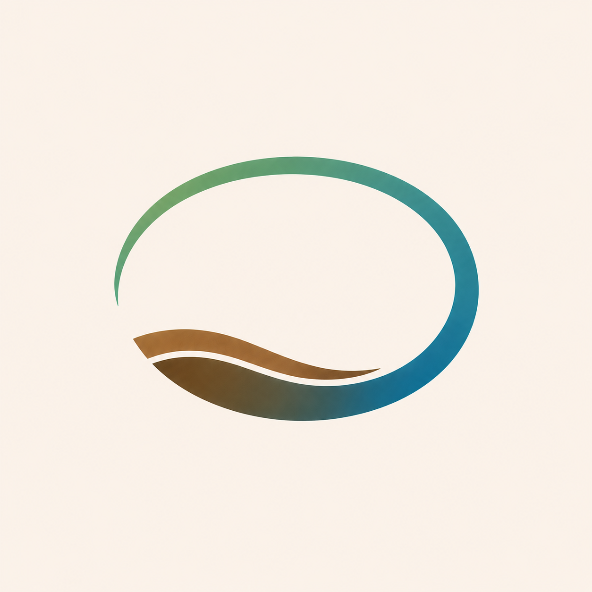
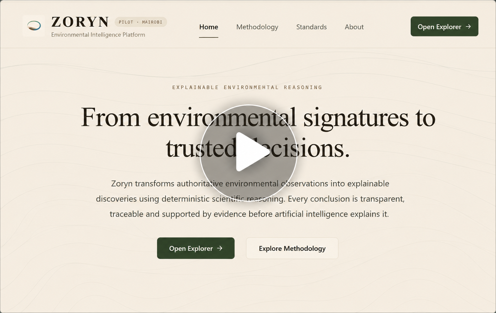
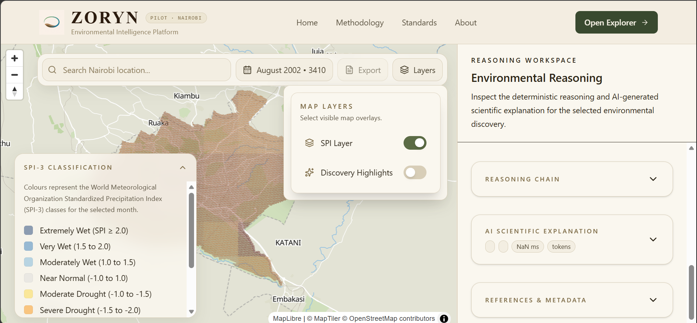
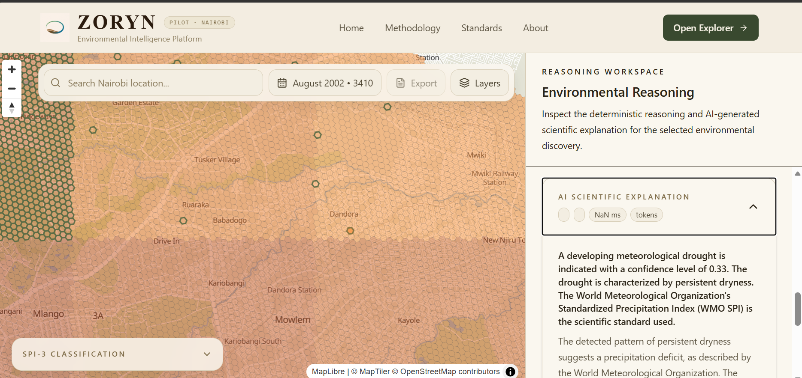

<div align="center">



# Zoryn

### Environmental Intelligence Through Explainable Reasoning

[]()
[]()
[]()
[]()

*Understanding environmental change through evidence, provenance and reasoning.*

</div>

---

## Overview

Zoryn is an environmental intelligence platform that transforms authoritative environmental observations into explainable insights. By combining scientific reasoning, historical environmental signatures, and complete evidence provenance, Zoryn enables users to understand **what is happening, why it is happening, and how similar conditions have evolved in the past.**

Rather than producing opaque predictions, every conclusion is transparent, traceable, and supported by evidence before artificial intelligence explains it.

---

## Features

- 🌍 Interactive H3-based environmental explorer
- 🧠 Signature-based environmental reasoning
- 🔎 Explainable AI with complete evidence provenance
- 📚 Knowledge graph-driven environmental intelligence
- 📈 Multi-temporal environmental pattern analysis
- ⚡ High-performance FastAPI backend
- 🛰️ Built entirely on open Earth observation datasets

---

## How It Works

```text
Environmental Data
        │
        ▼
Knowledge Graph
        │
        ▼
Signature Retrieval
        │
        ▼
Reasoning Engine
        │
        ▼
Evidence & Provenance
        │
        ▼
Explainable Insights
```

---

## Technology Stack

### Backend

- Python
- FastAPI
- DuckDB
- Apache Parquet
- Polars
- NumPy

### Frontend

- React
- TypeScript
- Vite
- Tailwind CSS
- Zustand
- TanStack Query
- MapLibre GL JS

### Geospatial

- Google Earth Engine
- H3
- GeoPandas
- Rasterio
- Shapely

### AI & Reasoning

- Grok
- Knowledge Graph
- Explainable AI (XAI)

---

## Project Structure

```text
backend/
frontend/
data/
docs/
tests/
```

---

## Getting Started

### Clone

```bash
git clone https://github.com/Issimonmutunga/zoryn.git
cd zoryn
```

### Backend

```bash
cd backend

pip install -r requirements.txt

uvicorn zoryn.rest.app:app --reload
```

### Frontend

```bash
cd frontend

npm install

npm run dev
```

---

## Demo

<p align="center">
  <a href="https://youtu.be/W6VMQSRtY4w">
    
  </a>
</p>

<p align="center">
  <strong>▶ Click the image above to watch the demo</strong>
</p>

---

## Screenshots

### Interactive Environmental Explorer

<p align="center">
  
</p>

Explore environmental observations through an interactive H3-based map with configurable environmental layers.

### Explainable AI Reasoning

<p align="center">
  
</p>

Every insight is accompanied by transparent reasoning, supporting evidence, confidence, provenance, and historical context.

---

## Vision

Zoryn is evolving into a live environmental intelligence platform capable of continuously ingesting environmental observations, detecting emerging patterns, retrieving historical analogues, and producing transparent, explainable environmental intelligence.

Its long-term vision is to unite:

- Environmental signatures
- Historical analogues
- Explainable reasoning
- Multi-criteria environmental analysis
- Knowledge graph intelligence

to support trusted environmental decision-making across governments, researchers, humanitarian organizations, and industry.

---

## Built With

- Python
- FastAPI
- React
- TypeScript
- Google Earth Engine
- H3
- DuckDB
- Apache Parquet
- Polars
- GeoPandas
- MapLibre GL JS
- Zustand
- Grok

---

## Contributing

Contributions, ideas, and discussions are welcome.

---

## License

MIT License.
