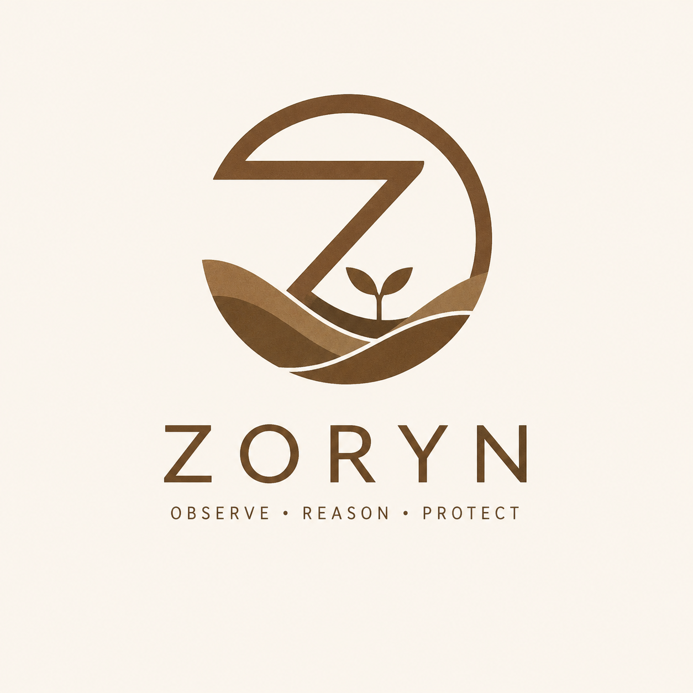

# <p align="center"></p>

<h1 align="center">Zoryn</h1>

<p align="center">
<b>An Explainable Environmental Reasoning Engine for Early Warning</b>
</p>

<p align="center">
Observe • Reason • Protect
</p>

---

## Overview

Zoryn is an environmental reasoning engine designed to infer emerging environmental hazards from scientific observations using transparent, explainable reasoning.

Unlike conventional machine learning systems that produce predictions with limited interpretability, Zoryn constructs an explicit chain of scientific reasoning from observations to environmental discoveries.

Every conclusion can be traced back to the observations, evidence, environmental patterns and scientific standards that produced it.

---

## Objectives

The pilot demonstrates that environmental hazards can be discovered through transparent reasoning rather than opaque prediction.

For every environmental conclusion, Zoryn answers:

* What is happening?
* Why is it happening?
* Which observations support the conclusion?
* Which scientific reasoning rule produced it?
* Which scientific standard supports the reasoning?

---

## Reasoning Pipeline

```text
Observation
      │
      ▼
Environmental Signature
      │
      ▼
Relationship
      │
      ▼
Evidence
      │
      ▼
Pattern
      │
      ▼
Hypothesis
      │
      ▼
Discovery
```

The reasoning process is deterministic, explainable and scientifically grounded.

---

## Current Scientific Rules

The pilot currently includes:

* Persistent Dryness Rule (WMO SPI)

The architecture is designed to accommodate additional reasoning rules including:

* Persistent Wetness
* Heatwave
* Vegetation Stress
* Flood Precursors
* Compound Hazards

---

## Scientific References

Environmental reasoning is supported by internationally recognised standards.

Current references include:

* World Meteorological Organization (WMO)
* Intergovernmental Panel on Climate Change (IPCC)
* Food and Agriculture Organization (FAO)
* United States Geological Survey (USGS)
* United Nations Office for Disaster Risk Reduction (UNDRR)

Reference material is available under:

```text
references/
```

---

## Project Structure

```text
src/
    zoryn/

scripts/

tests/

references/

docs/

data/
```

---

## Installation

Clone the repository:

```bash
git clone https://github.com/Issimonmutunga/zoryn.git
```

Create a virtual environment:

```bash
python -m venv .venv
```

Activate it.

Windows

```bash
.venv\Scripts\activate
```

Linux/macOS

```bash
source .venv/bin/activate
```

Install dependencies:

```bash
pip install -e .
```

---

## Running the Pipeline

Execute the reasoning engine:

```bash
python scripts/export_discoveries.py
```

Export the complete knowledge dataset:

```bash
python scripts/export_knowledge.py
```

---

## Validation

Zoryn includes independent validation scripts covering each stage of the reasoning pipeline.

Examples:

```bash
python scripts/validate_patterns.py

python scripts/validate_hypothesis.py

python scripts/validate_discoverer.py

python scripts/validate_knowledge.py
```

---

## REST API

Start the API:

```bash
python -m zoryn.rest.main
```

The API exposes persisted environmental discoveries for downstream applications and interactive mapping.

---

## Design Principles

Zoryn is built around a small set of guiding principles:

* Scientific correctness before software convenience.
* Explainability over opacity.
* Deterministic reasoning.
* Modular scientific rules.
* Streaming, constant-memory execution.
* Reproducible environmental analysis.

---

## Current Status

The pilot currently supports:

* Environmental reasoning pipeline
* Explainable discoveries
* Streaming execution
* Knowledge persistence
* REST API
* Validation framework

Future work focuses on expanding the scientific rule library and building interactive decision-support applications.

---

## License

This project is released under the MIT License.

---

<p align="center">
<b>Zoryn</b><br>
An Explainable Environmental Reasoning Engine for Early Warning
</p>
